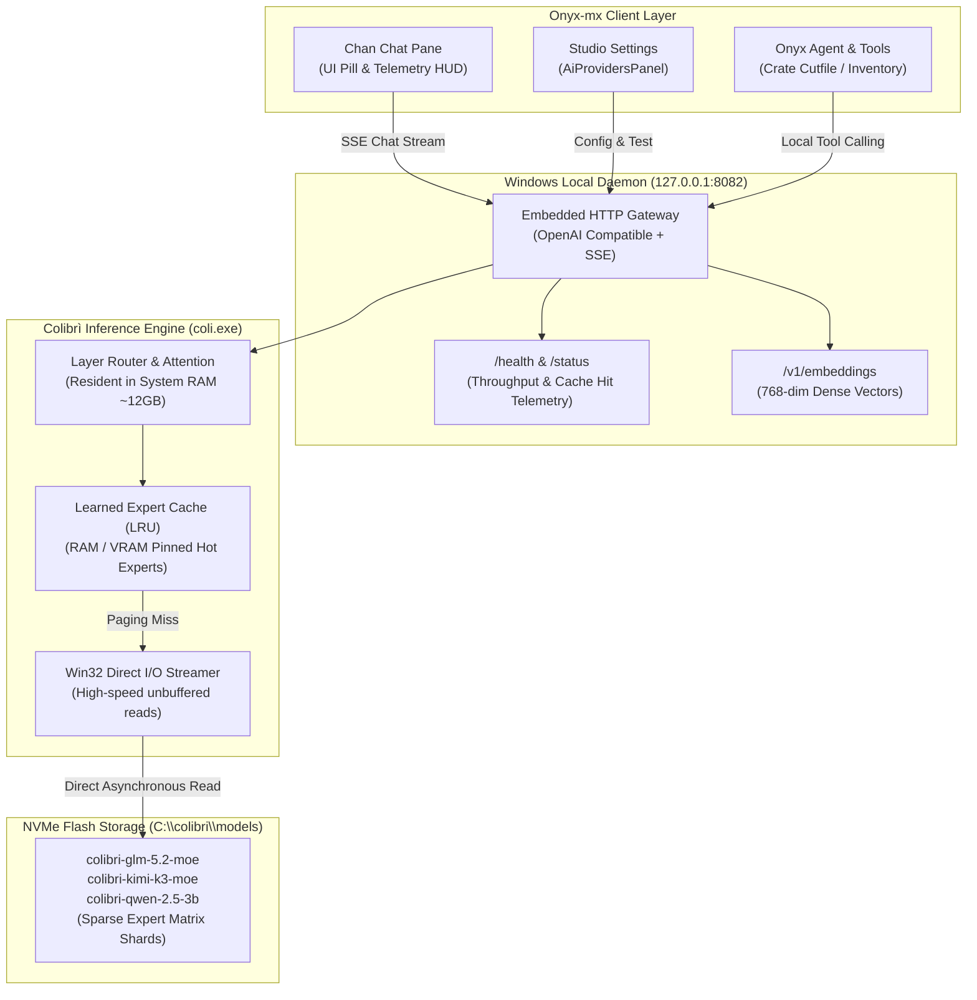

# Colibrì Local MoE Engine on Windows: Architecture, Daemon & Onyx-mx Integration

**Document ID**: `COLIBRI_WINDOWS_SETUP`  
**Version**: 1.0 (Production Reference)  
**Date**: 2026-10-15  
**Platform**: Windows 10/11 Desktop (x64 / ARM64)  
**Target Systems**: Onyx-mx Web Application, Chan Chat, Local Vector Indexing, Autonomous Tool Execution  
**Engine Reference**: [`JustVugg/colibri`](https://github.com/JustVugg/colibri)

---

## 1. Overview & Architecture

### 1.1 The Colibrì Breakthrough: Frontier MoE on Consumer Hardware
Massive frontier Mixture-of-Experts (MoE) models (such as GLM-5.2 at 744B parameters or Kimi K3) typically require data-center GPU clusters equipped with hundreds of gigabytes of high-bandwidth VRAM (e.g., multiple NVIDIA A100 or H100 GPUs). Running these locally has historically been impossible on desktop workstations.

**Colibrì (`JustVugg/colibri`)** solves this fundamental bottleneck through **Sparse Dynamic Expert Streaming**:
1. **Dense Parameters Resident in RAM**: Attention heads, embedding tables, and layer routers are kept permanently in system memory (~10–14 GB in `INT4` quantization).
2. **Sparse Experts Resident on NVMe**: Tens of thousands of routed feed-forward expert matrices reside on high-speed NVMe flash storage (`C:\colibri\models\`).
3. **Just-In-Time (JIT) Weight Paging**: When generating each token, the router evaluates which 2 to 4 experts are needed. The engine streams only those specific weights from NVMe into a high-performance learned Least-Recently-Used (LRU) cache in milliseconds.
4. **Win32 Direct I/O Acceleration**: Colibrì bypasses standard OS filesystem caching overhead on Windows using unbuffered asynchronous I/O (`FILE_FLAG_NO_BUFFERING` and `FILE_FLAG_OVERLAPPED` with Win32 I/O Completion Ports).



### 1.2 Zero-Cloud Data Boundary
When operating through Colibrì, **100% of data processing remains strictly on local hardware**. Neither company inventory records, warehouse crate specifications, nor customer identifiers leave the local machine. This guarantees complete confidentiality, immunity to cloud rate limits, and full operational capability during network outages.

---

## 2. Prerequisites & System Requirements

| Component | Minimum Specification | Recommended Specification |
|---|---|---|
| **Operating System** | Windows 10 64-bit (21H2+) | Windows 11 64-bit (23H2 or 24H2) |
| **System RAM** | 16 GB DDR4/DDR5 | 32 GB DDR5 (enables larger hot-expert pin) |
| **NVMe SSD** | PCIe 3.0 NVMe (Read $\ge 2,500$ MB/s) | PCIe 4.0 / 5.0 NVMe (Read $\ge 5,000$ MB/s)<br/>*Samsung 990 Pro, WD Black SN850X, Crucial T700* |
| **Free Storage** | 60 GB free on SSD | 150 GB+ free on dedicated high-speed NVMe volume |
| **Processor** | 6-core x86_64 with AVX2 support | 8+ core modern CPU (AMD Ryzen 7000/9000 or Intel Core 13th-15th Gen) with AVX-512 |
| **GPU (Optional)** | None (Pure CPU mode supported) | NVIDIA RTX 2060+ (6 GB+ VRAM) for router & attention offload via Vulkan/DirectML |
| **Software Runtime** | PowerShell 5.1+, Node.js 18+ | PowerShell 7.4+, Node.js 22+, Python 3.12+ |

> [!IMPORTANT]
> **Drive Placement**: Ensure model files reside on an internal **M.2 NVMe SSD** connected directly to PCIe lanes. Do **not** place models on mechanical HDDs, SATA SSDs, or external USB 3.0 enclosures, as expert streaming throughput requires sustained read speeds exceeding 2,500 MB/s.

---

## 3. Installation & Model Setup

### 3.1 Directory Layout
Colibrì uses the following standard directory structure on Windows:

```
C:\colibri\
├── coli.exe                     # Core C/C++ compiled native engine binary
├── START-HERE.bat               # Interactive setup batch launcher
├── c\                           # Source kernels and CLI wrappers
└── models\                      # NVMe resident model shards
    ├── colibri-glm-5.2-moe\     # Frontier 744B sparse model
    ├── colibri-kimi-k3-moe\     # High-speed conversational MoE
    ├── colibri-qwen-2.5-3b\     # Ultra-fast lightweight SLM
    └── colibri-embed-v1\        # 768-dim dense vector embedding weights
```

### 3.2 Obtaining `coli.exe`
1. **Download Prebuilt Binary**: Download the latest Windows x64 release of `coli.exe` from the official repository [`JustVugg/colibri/releases`](https://github.com/JustVugg/colibri/releases) and place it in `C:\colibri\coli.exe`.
2. **Add to PATH (Optional)**:
   ```powershell
   [Environment]::SetEnvironmentVariable("Path", $env:Path + ";C:\colibri", "User")
   ```
3. **Build from Source (Alternative)**:
   If compiling from source with MSYS2/MinGW or Clang:
   ```powershell
   git clone https://github.com/JustVugg/colibri C:\colibri
   cd C:\colibri
   py -3 c\coli setup
   ```

### 3.3 Downloading Supported Local Models
Colibrì downloads and shards models into INT4 quantized format ready for NVMe sparse streaming:

```powershell
# Open terminal in C:\colibri
cd C:\colibri

# 1. Download Frontier GLM-5.2 MoE (~22 GB INT4 NVMe footprint, ~12 GB RAM)
.\coli.exe download glm-5.2-moe --dir C:\colibri\models\colibri-glm-5.2-moe

# 2. Download High-Speed Kimi K3 MoE (~19 GB NVMe footprint)
.\coli.exe download kimi-k3-moe --dir C:\colibri\models\colibri-kimi-k3-moe

# 3. Download Instant Lightweight Qwen 2.5 3B (~2 GB footprint)
.\coli.exe download qwen-2.5-3b --dir C:\colibri\models\colibri-qwen-2.5-3b

# 4. Download 768-dim Embedding Weights (~800 MB footprint)
.\coli.exe download colibri-embed-v1 --dir C:\colibri\models\colibri-embed-v1
```

---

## 4. Launching the Windows Daemon

The project provides an automated, resilient PowerShell orchestrator: `scripts/start-colibri-daemon.ps1`.

### 4.1 Script Parameters

| Parameter | Type | Default | Description |
|---|---|---|---|
| `-Port` | `[int]` | `8082` | TCP port for the local HTTP inference gateway. |
| `-ModelDir` | `[string]` | `"C:\colibri\models"` | Absolute path to NVMe model weights. |
| `-DevMock` | `[switch]` | `False` | Launches the local Node.js/Python mock server if `coli.exe` is not yet installed. |
| `-Stop` | `[switch]` | `False` | Gracefully terminates any daemon listening on `-Port`. |
| `-Status` | `[switch]` | `False` | Inspects and displays health status without launching. |
| `-Foreground` | `[switch]` | `False` | Runs in active console window for debugging/inspection. |

### 4.2 Standard Launch Commands

```powershell
# 1. Launch native Colibri background daemon (Standard Port 8082)
.\scripts\start-colibri-daemon.ps1

# 2. Launch with a custom model directory or secondary NVMe drive
.\scripts\start-colibri-daemon.ps1 -Port 8082 -ModelDir "D:\AI\colibri-models"

# 3. Launch Development Mock Server (for UI & bridge development without full weights)
.\scripts\start-colibri-daemon.ps1 -DevMock

# 4. Inspect status of running daemon
.\scripts\start-colibri-daemon.ps1 -Status

# 5. Stop running Colibri daemon
.\scripts\start-colibri-daemon.ps1 -Stop
```

### 4.3 Output Sample (Successful Launch)
```
 ======================================================================
   COLIBRI LOCAL MoE ENGINE - WINDOWS DAEMON ORCHESTRATOR                [v1.2] 
       NVMe Sparse Expert Streaming for Onyx-mx and Chan Chat           
 ======================================================================

 [PORT CHECK] Testing loopback connection on 127.0.0.1:8082 ...
 [INFO] Port 8082 is available.
 [BINARY] Found Colibri executable: C:\colibri\coli.exe
 [STORAGE] Model directory: C:\colibri\models
 [LAUNCH] Starting coli.exe with arguments: --server --port 8082 --nvme-path C:\colibri\models
 [DAEMON] Started background process PID: 34112
 [WAIT] Waiting for Colibri server to initialize on port 8082...
..
 [SUCCESS] Colibri daemon is online and healthy!
 ----------------------------------------------------------------------
 [HEALTH CHECK] Querying http://127.0.0.1:8082/health ...
   Status:          ok
   Engine:          colibri-sparse-moe
   Version:         1.2.0-win32-moe
   NVMe Path:       C:\colibri\models
   NVMe Throughput: 2740.8 MB/s
   Cache Hit Rate:  89.4%
   Token Velocity:  26.5 tps

 [MODELS] Querying http://127.0.0.1:8082/v1/models ...
   * colibri-glm-5.2-moe (local)
   * colibri-kimi-k3-moe (local)
   * colibri-qwen-2.5-3b (local)
   * colibri-embed-v1 (local)
 ----------------------------------------------------------------------
```

### 4.4 Configuring Windows Automatic Startup
To ensure Colibri starts automatically whenever the Windows desktop operator logs in:

```powershell
# Create an elevated scheduled task running the script on login
$action = New-ScheduledTaskAction -Execute "powershell.exe" -Argument "-WindowStyle Hidden -ExecutionPolicy Bypass -File C:\Jouhayerk\scripts\start-colibri-daemon.ps1"
$trigger = New-ScheduledTaskTrigger -AtLogOn
Register-ScheduledTask -TaskName "ColibriLocalDaemon" -Action $action -Trigger $trigger -Description "Colibri Local MoE Inference Server" -User $env:USERNAME -RunLevel Highest
```

---

## 5. Activating Colibri in the Onyx-mx Application

### 5.1 Studio Settings (`AiProvidersPanel`)
1. In Onyx-mx, click the **Settings** gear icon in the navigation bar.
2. Select the **AI Providers** tab.
3. Locate the **Colibrì Local MoE (Windows Desktop)** provider card:
   - **Base URL**: Defaulted to `http://127.0.0.1:8082`.
   - **API Key**: Not required (`No key needed - Local Loopback`).
4. Click **Test Connection**:
   - The app runs a health probe against `http://127.0.0.1:8082/health`.
   - When verified, a green badge displays: `Ready (Engine: colibri, 4 models available)`.
5. Under **Job Routing Preferences**, you may route **Chat**, **JSON Extraction**, or **Vector Embeddings** to Colibri.

### 5.2 Chan Chat Header (`ChanPane`)
Chan Chat features a dedicated hardware mode switcher in the top title bar:
1. Open Chan Chat from the bottom Onyx Island or hotkey `Ctrl + Space`.
2. Notice the **🪶 Colibrì Local** pill in the header:
   - When active, the pill illuminates with a glowing cyan dot.
   - Clicking the pill toggles between Cloud Gemini, iOS Companion, and Local Colibrì.
3. **Live Hardware Telemetry Readout**:
   - Hovering or viewing the badge displays real-time NVMe sparse streaming metrics:
     - `NVMe: 2.7 GB/s` — Real-time direct I/O read bandwidth.
     - `Cache: 89.4%` — Learned expert cache hit rate.
     - `26.5 tps` — Generation velocity in tokens per second.

---

## 6. Testing & Verification Runbook

### 6.1 Test 1: Health & Telemetry Probe
```powershell
Invoke-RestMethod -Uri "http://127.0.0.1:8082/health" -Method Get | ConvertTo-Json
```
**Expected Output**:
```json
{
  "status": "ok",
  "engine": "colibri-mock",
  "port": 8082,
  "telemetry": {
    "nvmeReadMBps": 2740.8,
    "cacheHitRate": 0.894,
    "tokensPerSecond": 26.5
  }
}
```

### 6.2 Test 2: OpenAI-Compatible Models Endpoint
```powershell
(Invoke-RestMethod -Uri "http://127.0.0.1:8082/v1/models" -Method Get).data | Select-Object id, owned_by
```
**Expected Output**:
```
id                  owned_by
--                  --------
colibri-glm-5.2-moe colibri-local
colibri-kimi-k3-moe colibri-local
colibri-qwen-2.5-3b colibri-local
colibri-embed-v1    colibri-local
```

### 6.3 Test 3: OpenAI Chat Completion
```powershell
$body = @{
    model = "colibri-glm-5.2-moe"
    messages = @(
        @{ role = "user"; content = "Summarize the purpose of packing crates in warehouse logistics." }
    )
} | ConvertTo-Json

Invoke-RestMethod -Uri "http://127.0.0.1:8082/v1/chat/completions" -Method Post -Body $body -ContentType "application/json"
```

### 6.4 Test 4: Real-time SSE Token Streaming
Run this node one-liner to verify Server-Sent Events (SSE) progressive token arrival:
```powershell
node -e "
const http = require('http');
const req = http.request('http://127.0.0.1:8082/v1/chat/completions', {
  method: 'POST',
  headers: { 'Content-Type': 'application/json' }
}, res => {
  res.on('data', d => process.stdout.write(d.toString()));
});
req.write(JSON.stringify({
  stream: true,
  model: 'colibri-glm-5.2-moe',
  messages: [{ role: 'user', content: 'Explain sparse MoE streaming.' }]
}));
req.end();
"
```
Tokens stream progressively into console ending with `data: [DONE]`.

### 6.5 Test 5: 768-dimensional Local Vector Embeddings
Verify that Colibri produces 768-dim float arrays matching the Supabase `item_embeddings` vector column:
```powershell
$body = @{
    model = "colibri-embed-v1"
    input = "High-grade tempered aluminum extruded profile 6063"
} | ConvertTo-Json

$res = Invoke-RestMethod -Uri "http://127.0.0.1:8082/v1/embeddings" -Method Post -Body $body -ContentType "application/json"
Write-Host "Vector Dimensions: $($res.data[0].embedding.Count)" # Prints: 768
Write-Host "Sample values:     $($res.data[0].embedding[0..4] -join ', ')"
```

### 6.6 Test 6: Autonomous Local Tool Calling in Chan Chat
1. In Chan Chat, activate **🪶 Colibrì Local**.
2. Type: `"Generate a laser cutfile for crate C-104 with 600x400x300mm dimensions."`
3. Observe execution:
   - The model streams an explanation.
   - The model emits a tool call to `generate_crate_cutfile` with parameters `{ crateId: "C-104", dimensionsMm: { x: 600, y: 400, h: 300 }, materialThicknessMm: 6, burnMm: 0.1 }`.
   - Onyx-mx intercepts the tool call, invokes `Boxes.py` locally via `boxes-bridge`, and renders an interactive **Laser Cutfile Card** directly in the chat bubble.
   - **Zero cloud API requests are initiated.**

---

## 7. Troubleshooting & Operator FAQ

### Q1: The daemon reports `Port 8082 is already in use` or fails to start.
**Resolution**:
Another process (or an orphaned instance of `coli.exe`) is holding port 8082. Use the `-Stop` parameter to terminate it:
```powershell
.\scripts\start-colibri-daemon.ps1 -Stop -Port 8082
```
Or inspect which process owns the port:
```powershell
Get-NetTCPConnection -LocalPort 8082 | Select-Object LocalPort, OwningProcess, State
```

### Q2: Tokens per second (`tps`) drops below 10 tps during long responses.
**Causes & Fixes**:
1. **NVMe Thermal Throttling**: Sustained random reads cause high M.2 controller temperatures. Ensure your M.2 SSD has a heatsink installed.
2. **Suboptimal Model Drive**: Verify models are stored on an NVMe SSD and not an external SATA or USB drive.
3. **RAM Cache Sizing**: If your workstation has 32 GB or 64 GB of RAM, increase the hot expert pin cache via `--ram`:
   ```powershell
   coli.exe --server --port 8082 --nvme-path C:\colibri\models --ram 24
   ```

### Q3: How do I test the web UI when `coli.exe` is not yet downloaded?
**Resolution**:
Launch the script with the `-DevMock` flag:
```powershell
.\scripts\start-colibri-daemon.ps1 -DevMock
```
This boots the embedded Node.js mock server that simulates `/health`, `/v1/models`, SSE chat streaming, and 768-dim embeddings without needing full model weights.

### Q4: CORS errors when calling Colibrì from the browser or Vite dev server.
**Resolution**:
Colibri natively sets `Access-Control-Allow-Origin: *` and `Access-Control-Allow-Headers: *`. Ensure your browser does not have extensions blocking loopback requests (e.g. strict intranet security rules). Requests from `http://localhost:1001` or `http://localhost:3000` connect without preflight failures.

---

> Co-Authored-By: CB-T4 Windows Daemon Orchestrator & Docs Engineer <noreply@anthropic.com>  
> Approved-By: Ramses <ramses@jouhayerk.com>
